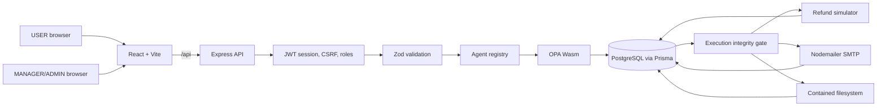
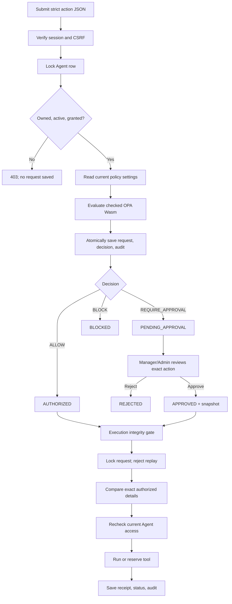
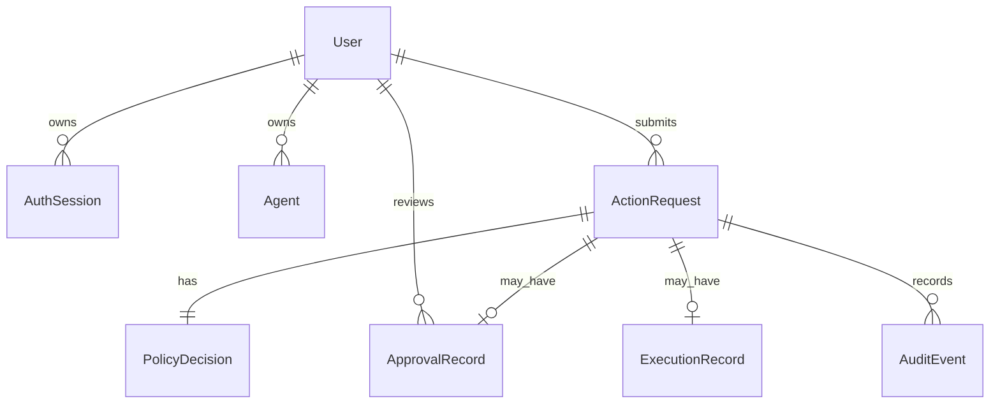

# AgentShield

AgentShield is a local security gateway for agent-requested actions. It sits
between a user or agent and a controlled tool, evaluates deterministic policy,
requires a Manager/Admin decision when necessary, verifies that execution still
matches the authorized action, and records durable evidence of the result.

The current implementation demonstrates three domains:

- **Refund:** deterministic INR thresholds and a simulated refund receipt.
- **Email:** recipient-domain policy, full-message approval, simulation, and
  optional real SMTP delivery through Nodemailer.
- **Sandbox Files:** real contained READ, WRITE, CHANGE, and DELETE operations
  inside a dedicated demo folder.

This README is the primary technical handbook for the repository. For the
chronological implementation and verification record, see
[`docs/IMPLEMENTATION_GUIDE.md`](docs/IMPLEMENTATION_GUIDE.md). For a rehearsed
demo journey, see [`docs/PRESENTATION_WALKTHROUGH.md`](docs/PRESENTATION_WALKTHROUGH.md).

> [!IMPORTANT]
> AgentShield does not use an LLM to authorize critical actions. Open Policy
> Agent (OPA) produces deterministic decisions. Authentication, ownership,
> approval snapshots, exact-action comparison, replay prevention, SMTP safety,
> and filesystem containment are enforced by backend code.

## Contents

1. [Problem and scope](#problem-and-scope)
2. [Technology stack](#technology-stack)
3. [System architecture](#system-architecture)
4. [Shared action lifecycle](#shared-action-lifecycle)
5. [Backend architecture](#backend-architecture)
6. [Authentication and roles](#authentication-and-roles)
7. [Agent registry](#agent-registry)
8. [OPA integration](#opa-integration)
9. [Database design](#database-design)
10. [Refund domain](#refund-domain)
11. [Email domain](#email-domain)
12. [Sandbox Files domain](#sandbox-files-domain)
13. [Frontend architecture](#frontend-architecture)
14. [REST API](#rest-api)
15. [Local setup](#local-setup)
16. [Accounts, agents, and demo fixtures](#accounts-agents-and-demo-fixtures)
17. [Commands](#commands)
18. [Testing](#testing)
19. [Security properties](#security-properties)
20. [Errors and troubleshooting](#errors-and-troubleshooting)
21. [Project structure](#project-structure)
22. [Remaining work](#remaining-work)

## Problem and scope

An agent can propose an action, but proposing it should not automatically grant
permission to perform it. AgentShield answers seven questions:

1. Is the human user authenticated?
2. Is the agent registered, active, owned by that user, and granted this tool?
3. Does deterministic policy allow, review, or block this request?
4. If a person approved it, what exact action did they approve?
5. Immediately before execution, is the action still identical and permitted?
6. Has this request already executed or reserved an external attempt?
7. What durable evidence explains the decision and result?

These checks are separate layers. Hiding a button in React is not authorization.
The Express backend repeats all security checks and controls the only code paths
that can create receipts, send SMTP email, or touch sandbox files.

### Implemented

- React dashboard for User, Manager, and Admin roles.
- bcrypt password hashes, JWT HttpOnly cookies, database-backed revocable
  sessions, CSRF protection, and login rate limiting.
- Registered agents with an owner, active status, and explicit tool grants.
- Deterministic OPA policies for Refund, Email, and Sandbox Files.
- Versioned Manager/Admin policy settings stored in PostgreSQL.
- Atomic request and policy-decision persistence.
- Human review with reviewer identity and an exact action snapshot.
- Execution-time snapshot comparison and current Agent rechecks.
- One execution or durable external-attempt reservation per request ID.
- Request-scoped audit events and persistent receipts.
- Optional real SMTP with TLS and no automatic resend.
- Real contained file operations with path, symlink, size, preview, and digest controls.
- Full-stack local supervisor for database, API, and Vite.

### Honest boundaries

- AgentShield does not globally intercept Codex, Claude, Gemini, MCP, browser,
  or operating-system actions.
- Agent IDs are registered identifiers under a human session, not independent credentials.
- Refunds are simulated. No payment provider or real money is used.
- SMTP acceptance is not proof of inbox delivery; bounce/read tracking is absent.
- The sandbox is a dedicated demo folder, not unrestricted computer access or a
  production isolation platform. On Vercel it uses temporary function storage,
  which can disappear between invocations or deployments.
- Approval expiry/revocation, MFA, password reset, public signup, central policy
  distribution, audit search, and production hardening remain future work.
- Audit events are append-only through the app, not immutable against a database admin.
- No AI classifier participates in authorization.

## Technology stack

| Layer | Technology | Purpose |
|---|---|---|
| Browser UI | React 19, JavaScript | Dashboard, forms, review, receipts, audit |
| UI components | Material UI 7, Emotion | Accessible controls and responsive layout |
| Frontend tooling | Vite 7 | Dev server, `/api` proxy, production build |
| API runtime | Node.js, Express 5 | Middleware, routes, services, error mapping |
| Validation | Zod 4 | Strict domain request and settings schemas |
| Policy | OPA Rego compiled to Wasm | Deterministic ALLOW / REQUIRE_APPROVAL / BLOCK |
| OPA runtime | `@open-policy-agent/opa-wasm` 1.10.0 | Embedded evaluation inside Node.js |
| Database | PostgreSQL | Durable identity, requests, decisions, review, execution, audit |
| ORM | Prisma 6.12 | Models, migrations, transactions |
| Authentication | bcryptjs, jsonwebtoken, cookie-parser | Hashes, JWT cookies, parsing |
| Rate limiting | express-rate-limit | Bounded login attempts per process/IP |
| Email | Nodemailer 10.1.7 | Authenticated TLS SMTP |
| Files | Node `fs/promises`, `path`, `crypto` | Contained operations and SHA-256 |
| Testing | Vitest 5, Supertest 7 | Policy, API, SMTP, sandbox, failure checks |

OPA runs inside Express. There is no separate OPA HTTP server. Committed `.wasm`
assets are sufficient for runtime; the OPA CLI is needed only when rebuilding rules.

## System architecture



The frontend never connects directly to PostgreSQL, OPA, SMTP, or the filesystem.
All effects pass through backend services that own authorization, locking,
comparison, reservation, dispatch, and audit behavior.

## Shared action lifecycle

All three domains reuse one lifecycle. Only the policy adapter and final tool differ.



| OPA result | Initial status | Meaning |
|---|---|---|
| `ALLOW` | `AUTHORIZED` | Matching action may execute without review |
| `REQUIRE_APPROVAL` | `PENDING_APPROVAL` | Manager/Admin must decide |
| `BLOCK` | `BLOCKED` | Execution is forbidden |

Policy changes affect only new submissions. Existing records keep their original
policy version and settings snapshot.

## Backend architecture

### Express entry

`backend/src/app.js` parses JSON with a 16 KB limit, parses cookies, sends
`Cache-Control: no-store` for API responses, mounts routers, and maps expected
policy/email/database/JSON failures to stable HTTP errors.

`backend/src/server.js` starts Express on port 3000 after required policy assets
load. Missing or mismatched policy assets stop startup instead of weakening rules.

### Routes and controllers

Routes select middleware and controllers. `actionRoutes.js` requires a valid
session and CSRF token, then adds Manager/Admin middleware for pending-list,
review, and sandbox-preview endpoints.

`actionController.js` validates body, UUID, and query values with Zod, invokes a
service, and converts its structured result into HTTP. It never trusts a client
for request owner, reviewer, policy result, email mode/sender, or receipt.

### Services and repository

- `submissionService.js`: creation transaction, Agent check, settings read,
  domain-policy selection.
- `executionService.js`: ActionRequest lock, replay refusal, snapshot selection,
  exact comparison, current Agent recheck, tool dispatch/reservation.
- `authService.js`: JWT, database session, CSRF, and role middleware.
- `agentService.js`: Agent row locking and access errors.
- Domain policy services: validate OPA input and map decisions to statuses.
- Dispatch services: handle irreversible SMTP/filesystem effects after reservation.
- `actionRepository.js`: persist/retrieve requests, decisions, approvals, execution,
  and audit pages.

### Domain adapters

- `refundSimulator.js`: pure simulated refund receipt.
- `emailDelivery.js`: SMTP config and hardened Nodemailer transport.
- `emailDispatchService.js`: one reserved send and final outcome.
- `sandboxFileTool.js`: safe logical-to-physical mapping and real file operations.
- `sandboxDispatchService.js`: one reserved filesystem attempt and final outcome.

## Authentication and roles

Accounts are created locally; there is no public signup. `create-user.js` stores a
bcrypt cost-12 hash. Passwords require at least 12 characters and at most 72 UTF-8 bytes.

`POST /api/auth/login` requires strict JSON, `X-AgentShield-Client: dashboard`,
an allowed Origin when supplied, and compliance with a 20-attempt/15-minute
in-memory limiter. A dummy bcrypt hash is checked for unknown emails.

Successful login creates an `AuthSession` containing User ID, a random 32-byte
CSRF token, and a 30-minute expiry. The signed HS256 JWT uses the User ID as
subject and session UUID as JWT ID. Verification fixes algorithm, issuer,
audience, UUID shapes, expiry, active User, and the live AuthSession row.

The session cookie is HttpOnly, SameSite=Strict, scoped to `/api`, and Secure in
production. It is never returned in JSON or stored in `localStorage`. Logout
deletes the AuthSession row and clears the cookie.

Non-GET requests require `X-CSRF-Token`. The backend compares it to the session
value with `timingSafeEqual`.

- USER accesses only owned requests.
- MANAGER/ADMIN access all requests, review pending requests, preview pending
  sandbox CHANGE/DELETE files, and edit policies.
- Review authority does not permit submission through another user's Agent.
- Unauthorized User object access looks like a missing request (404).

## Agent registry

Each Agent has an ID, name, owner, active flag, and explicit grants from
`REFUND`, `SEND_EMAIL`, and `SANDBOX_FILE`.

Submission locks the row with `SELECT ... FOR UPDATE` and checks:

1. Agent exists.
2. Agent belongs to the authenticated caller.
3. Agent is active.
4. Agent has the exact requested grant.

Execution repeats access checks against the original request owner. Disabling,
deleting, reassigning, or withdrawing a grant after approval prevents execution.
Restoring access may permit a later matching attempt, but does not rewrite approval.

Agent IDs are identifiers, not independent credentials. Registration/configuration
are local operator commands; there is no public management API.

## OPA integration

Each domain has readable Rego, compiled Wasm, and a manifest under
`backend/policies`:

- `<domain>.rego`
- `<domain>.wasm`
- `<domain>.manifest.json`

`opaPolicy.js` verifies engine, rule revision, exact
`agentshield/<domain>/decision` entrypoint, normalized source SHA-256, and Wasm
SHA-256 before loading the official SDK.

Evaluation must return exactly one `ALLOW`, `REQUIRE_APPROVAL`, or `BLOCK`.
Unknown/missing/multiple output becomes `PolicyUnavailableError`; the API returns
503 and the creation transaction saves no partial request.

A version such as `opa-email-r1-v4` means compiled rule revision `r1` and database
settings version `4`. Settings edits increment the database version without a
Rego rebuild. Rego edits require:

```bash
cd backend
npm run policy:build
```

Use official OPA 1.21.1, or set `OPA_BINARY`. Commit Rego, Wasm, and manifest together.

## Database design

Prisma Client/CLI are pinned to 6.12. PostgreSQL is the persistence authority.

| Model | Purpose |
|---|---|
| `User` | Email, password hash, role, active status |
| `AuthSession` | Revocable session, CSRF token, expiry |
| `Agent` | Owner, active status, grants |
| `ActionRequest` | Original action, target, arguments, mode/sender, owner, status |
| `PolicyDecision` | Outcome, reason, version, settings snapshot |
| `ApprovalRecord` | Reviewer and exact approved snapshot |
| `ExecutionRecord` | One receipt/reservation per request |
| `AuditEvent` | Ordered request evidence |
| `RefundPolicy` | Current refund limits/version |
| `EmailPolicy` | Internal/blocked domains, external action/version |
| `SandboxPolicy` | Prefixes, operation outcomes, size/version |



PolicyDecision, ApprovalRecord, and ExecutionRecord request IDs are unique. The
unique ExecutionRecord is a second replay defense after request locking/state checks.

Submission atomically locks Agent, checks access, reads settings, evaluates OPA,
and creates ActionRequest + PolicyDecision + initial audits. Review/execution use
parameterized `SELECT ... FOR UPDATE` on ActionRequest. Competing operations wait
and recheck state.

Policy updates use optimistic version matching. A stale manager gets
`409 POLICY_CHANGED` instead of overwriting another manager's settings.

## Refund domain

```json
{
  "agentId": "Demo-Refund",
  "action": "REFUND",
  "target": "order-123",
  "arguments": { "amount": 8000, "currency": "INR" }
}
```

Amount is a positive JSON number; numeric strings are rejected. Currency is INR.

Default policy:

| Amount | Decision | Status |
|---|---|---|
| `0 < amount <= 5,000` | ALLOW | AUTHORIZED |
| `5,000 < amount <= 20,000` | REQUIRE_APPROVAL | PENDING_APPROVAL |
| `amount > 20,000` | BLOCK | BLOCKED |

Manager/Admin can version `autoApproveLimit` and `maxAllowedRefund`. New requests
use current settings; existing requests keep saved settings.

Flow:

1. Zod validates refund shape.
2. Submission locks Agent and requires REFUND.
3. Current RefundPolicy is read inside the transaction.
4. `policyService` passes action, INR, amount, and limits to refund Wasm.
5. Request, decision, settings snapshot, and two audits save atomically.
6. Approval stores exact agent/action/target/amount/currency.
7. Execution deep-compares the complete action and rechecks Agent.
8. `refundSimulator` creates a UUID receipt; no payment provider is called.
9. One ExecutionRecord, EXECUTED status, and REFUND_EXECUTED audit commit.

Changed details return `EXECUTION_MISMATCH`; pending/blocked/rejected requests
cannot execute; removed grants block approved execution; repeats return
`REPLAY_DETECTED` and preserve the first receipt.

## Email domain

```json
{
  "agentId": "Demo-Email",
  "action": "SEND_EMAIL",
  "target": "customer@example.com",
  "arguments": {
    "subject": "Project update",
    "body": "The update is ready.\nPlease review."
  }
}
```

Validation permits one normalized recipient, subject 1-200 characters, and
nonblank plain-text body up to 8,000 UTF-8 bytes. It rejects HTML, attachments,
CC/BCC, arrays, unsafe control characters, and extra fields. Agent needs SEND_EMAIL.

Default EmailPolicy:

- Internal: `agentshield.test`
- Blocked: `blocked.example`
- External action: `REQUIRE_APPROVAL`
- Version: 1

Exact domains and subdomains match; lookalikes do not. Blocked wins. External can
be REQUIRE_APPROVAL or BLOCK, never automatic ALLOW. OPA sees recipient domain
and settings; Zod and snapshots protect subject/body. No content classification
or DLP is claimed.

### Simulation

`EMAIL_DELIVERY_MODE=SIMULATED` creates an EMAIL_SIMULATED nondelivery receipt.
No provider is contacted.

### SMTP

```dotenv
EMAIL_DELIVERY_MODE="SMTP"
SMTP_HOST="smtp.gmail.com"
SMTP_PORT="465"
SMTP_USER="sender@example.com"
SMTP_PASSWORD="provider-app-password"
SMTP_FROM="sender@example.com"
EMAIL_ALLOWED_RECIPIENTS="optional-shortcut@example.com"
```

Allowed recipients are optional form shortcuts, not an enforcement list. Invalid
SMTP configuration returns 503; there is no silent fallback. New requests save
backend-selected mode and sender, so later configuration cannot convert old
simulated authorization into a real send.

Nodemailer uses port 465 immediate TLS or port 587 required STARTTLS, TLS 1.2+,
certificate verification, authentication, explicit envelope, bounded timeouts,
disabled debug/file/URL access, and the exact authorized text message. Credentials
never enter snapshots, receipts, audit, or frontend config responses.

### Reserve, send, finalize

Real email is outside the database transaction because a rollback cannot unsend it.

```mermaid
sequenceDiagram
    participant UI
    participant API as executionService
    participant DB as PostgreSQL
    participant SMTP as Nodemailer/SMTP
    UI->>API: Execute exact email
    API->>DB: Lock/recheck; commit DISPATCHING reservation
    API->>SMTP: Send saved recipient, subject, text body
    alt accepted
        SMTP-->>API: accepted
        API->>DB: ACCEPTED + EXECUTED + audit
    else error/rejection/timeout
        SMTP-->>API: uncertain
        API->>DB: UNKNOWN + FAILED + audit
    end
```

The stable Message-ID is request-derived. One unique ExecutionRecord prevents a
second attempt under that request. There is no automatic resend because timeout
may occur after acceptance. Later calls return EMAIL_ATTEMPT_EXISTS or replay.
If final persistence fails, reservation remains and API returns EMAIL_OUTCOME_UNKNOWN.

Approval of a pending external SMTP request triggers sending after approval
commits. Policy-allowed SMTP still uses the explicit send action.

ACCEPTED means the SMTP server accepted the recipient, not proven inbox delivery.

## Sandbox Files domain

The API accepts logical paths, never OS paths:

```text
workspace/team/notes.txt
          |
          +--> backend/demo-workspace/team/notes.txt
```

Path schema accepts 1-240 characters in safe lowercase `/`-separated segments.
It rejects spaces, empty/dot segments, `..`, backslashes, hidden names, drive
paths, and malformed input before policy/disk access.

Defaults:

- Allowed: `workspace/`
- Protected: `workspace/protected/`
- READ/WRITE: ALLOW
- CHANGE/DELETE: REQUIRE_APPROVAL
- Max WRITE/CHANGE content: 8,000 UTF-8 bytes

Managers may narrow prefixes, add protected prefixes, change per-operation
outcomes, and lower the limit. Permanent workspace containment and protected
block cannot be bypassed.

Defense layers:

1. Zod validates logical path, operation, strict arguments, text, and hard ceiling.
2. OPA rejects outside/protected/unsupported actions.
3. Settings adapter applies configured prefixes, operation outcome, and limit.
4. Resolver strips `workspace/`, joins below resolved sandboxDirectory, and
   confirms root + platform separator.
5. `lstat` requires non-symlink parent directories.
6. Targets must be regular non-symlink files; `O_NOFOLLOW` is used where supported.

Normal root is `backend/demo-workspace`; tests use a process-specific temp folder.
Vercel Functions have a read-only bundle, so the hosted classroom demo maps this
root to `/tmp/agentshield-demo-workspace`. That directory is isolated from the
application bundle but is ephemeral and must not be treated as durable storage.

| Operation | OS behavior | Safety |
|---|---|---|
| READ | Open read-only, verify size/type, return UTF-8 | Maximum 8,000 bytes |
| WRITE | `O_WRONLY | O_CREAT | O_EXCL`, mode 0600 | New file only; no overwrite |
| CHANGE | Verify digest, open read/write, write offset 0, truncate | Full replacement of reviewed version |
| DELETE | Verify digest, unlink regular file | Delete reviewed version only |

### Preview and digest binding

Manager/Admin preview for pending CHANGE/DELETE returns current text, bytes, and
SHA-256, never physical path. Approval sends the digest. The repository locks the
request, rereads the file, and returns FILE_PREVIEW_CHANGED if it differs. The
digest is saved in ApprovalRecord.snapshot. Execution rereads/hashes again, so a
post-approval modification is refused. Old approvals without digest return
FILE_PREVIEW_REQUIRED.

### Durable reservation

Disk changes cannot roll back with PostgreSQL. Execution commits an ExecutionRecord
with DISPATCHING and SANDBOX_FILE_RESERVED before disk access. Dispatch then
finalizes EXECUTED/SANDBOX_FILE_EXECUTED or FAILED/SANDBOX_FILE_FAILED. If final
persistence fails, API returns SANDBOX_OUTCOME_UNKNOWN; inspect the folder. The
reserved request is never auto-retried.

## Frontend architecture

React is a backend client, not policy authority.

| Component | Responsibility |
|---|---|
| `AuthGate.jsx` | Session recovery, login, temporary outage UI |
| `DomainSelector.jsx` | Refund/Email/Sandbox navigation |
| `AgentPicker.jsx` | Owned Agents filtered by selected grant |
| `PendingRequests.jsx` | Manager queue, oldest first |
| Policy settings components | Versioned domain editors |
| `ActionDetails.jsx` | Request, policy, approval, sandbox current/proposed labels |
| `ExecutionReceipt.jsx` | Simulation, SMTP, and file outcomes |
| `App.jsx` | Forms, selection, polling, review/execution coordination |

Vite proxies `/api` to port 3000. JWT stays in HttpOnly cookie. CSRF stays in
module memory and restores through `/me`. Selected request IDs are stored per User
in localStorage but backend object access still controls retrieval. Selected
requests and pending queues poll every four seconds. AbortControllers and ID
checks prevent stale responses overwriting new state. React renders saved content
as text. UI changes cannot bypass backend execution checks.

## REST API

Action routes require session; non-GET routes require CSRF.

### Auth and agents

| Method | Path | Purpose |
|---|---|---|
| POST | `/api/auth/login` | Create session, set cookie, return User/CSRF |
| GET | `/api/auth/me` | Restore session/CSRF/expiry |
| POST | `/api/auth/logout` | Revoke session and clear cookie |
| GET | `/api/agents` | List current User's Agents |

### Policy - Manager/Admin

| Method | Path | Purpose |
|---|---|---|
| GET/PUT | `/api/policy` | Read/save refund settings |
| GET/PUT | `/api/policy/email` | Read/save email settings |
| GET/PUT | `/api/policy/sandbox` | Read/save sandbox settings |

### Actions

| Method | Path | Purpose |
|---|---|---|
| POST | `/api/actions` | Validate Agent, evaluate policy, save request |
| GET | `/api/actions/email-delivery` | Safe email mode/readiness metadata |
| GET | `/api/actions/pending` | Manager pending queue, max 100 displayed |
| GET | `/api/actions/:id` | Saved request/policy/review/execution |
| GET | `/api/actions/:id/file-preview` | Pending CHANGE/DELETE preview |
| POST | `/api/actions/:id/review` | APPROVE/REJECT; digest for file change/delete |
| POST | `/api/actions/:id/execute` | Execute complete matching action |
| GET | `/api/actions/:id/audit?after=0&limit=100` | Ordered audit page |

GET never recalculates policy. Refused pre-creation submissions have no request
UUID/audit. Denied executions append EXECUTION_DENIED when database is available.
Responses never include password hashes or SMTP credentials.

## Local setup

### Install and migrate

```bash
npm install
cd backend
npm install
npm run prisma:generate
npx prisma migrate deploy
```

### Configure `backend/.env`

```dotenv
DATABASE_URL="postgresql://..."
JWT_SECRET="random-secret-at-least-32-bytes"
APP_ORIGIN="http://localhost:5173"
EMAIL_DELIVERY_MODE="SIMULATED"
```

Generate secret:

```bash
node -e "console.log(require('node:crypto').randomBytes(48).toString('hex'))"
```

Do not commit `.env`. Production Secure cookies require HTTPS.

### Start everything

From repository root:

```bash
npm run dev
```

The supervisor monitors database 51214, Express 3000, and Vite 5173. It probes
ports every five seconds, bounds restart storms, checks a real DB query every 30
seconds, and restarts only the DB process it started. It reuses state and never
resets records. Open <http://localhost:5173>.

Separate alternative:

```bash
# backend terminal
cd backend
npm run db:local
npm start

# root frontend terminal
npm run frontend:dev
```

The root supervisor is recommended for demos.

## Accounts, agents, and demo fixtures

Create account from backend PowerShell:

```powershell
$accountPassword = Read-Host 'Password (12 characters, max 72 UTF-8 bytes)' -AsSecureString
[System.Net.NetworkCredential]::new('', $accountPassword).Password | npm run user:create -- manager@example.com MANAGER
$accountPassword = $null
```

Register/configure:

```bash
npm run agent:register -- SupportAgent-01 "Support Agent" owner@example.com active REFUND
npm run agent:register -- MailAgent-01 "Mail Agent" owner@example.com active SEND_EMAIL
npm run agent:register -- FileAgent-01 "File Agent" owner@example.com active SANDBOX_FILE
npm run agent:configure -- SupportAgent-01 active REFUND,SEND_EMAIL
npm run agent:configure -- SupportAgent-01 active none
```

Demo setup:

```powershell
.\scripts\setup-demo.ps1
```

It prompts for hidden passwords and provisions:

- `user@agentshield.test` USER
- `manager@agentshield.test` MANAGER
- Demo-Sandbox: active SANDBOX_FILE
- Demo-Email: active SEND_EMAIL
- Demo-Refund and Demo-Revocable: active REFUND
- Demo-NoRefund: active, no grants
- Demo-Disabled: inactive REFUND

Repeat with the same credentials to restore demo Agent settings without deleting
requests. Conflicts roll back the setup transaction. Use separate browser contexts
for User/Manager because normal tabs share cookies.

## Commands

### Root

| Command | Purpose |
|---|---|
| `npm run dev` | Full local supervisor |
| `npm run demo:dev` | Same supervisor alias |
| `npm run frontend:dev` | Vite only |
| `npm run build` | Production frontend bundle |
| `npm run preview` | Preview built frontend |

### Backend

| Command | Purpose |
|---|---|
| `npm start` | Express normally |
| `npm run dev` | Express watch mode |
| `npm run db:local` | Stateful local development DB |
| `npm run prisma:generate` | Generate Prisma Client |
| `npm run db:migrate -- --name <name>` | Author migration |
| `npx prisma migrate deploy` | Apply committed migrations |
| `npm run policy:build` | Compile all Rego policies |
| `npm run test:policy` | Standalone OPA tests |
| `npm test` | Full Vitest suite on isolated DB |
| `npm run user:create -- <email> <role>` | Create User, password stdin |
| `npm run agent:register -- ...` | Register Agent |
| `npm run agent:configure -- ...` | Update active/grants |
| `npm run demo:setup` | JSON/stdin fixture setup |
| `npm run email:verify` | Verify SMTP without sending |

## Testing

Database tests delete fixtures. Use only a migrated disposable DB and set:

```dotenv
AGENTSHIELD_TEST_DATABASE=1
```

The suite refuses database work without the marker.

| Test | Focus |
|---|---|
| `policy.test.js` | Refund OPA/assets/failure |
| `emailPolicy.test.js` | Domain matching/custom settings |
| `sandboxPolicy.test.js` | Boundary/prefix/outcome/size |
| `actions.test.js` | Create/review/execute/audit |
| `permissions.test.js` | Ownership/grants/rechecks |
| `agents.test.js` | Registration/configuration |
| `email.test.js` | Email API/snapshots/simulation |
| `emailDelivery.test.js` | SMTP reservation/outcome/races |
| `sandbox.test.js` | Preview/hash/replay/failure |
| `sandboxFileTool.test.js` | Direct contained file behavior |
| `reliability.test.js` | Failure paths |

Policy tests without DB:

```bash
cd backend
npm run test:policy
```

Full isolated run:

```bash
npm test -- --testTimeout=30000 --hookTimeout=30000
```

Frontend:

```bash
cd ..
npm run build
```

Vitest files run sequentially because DB suites delete fixtures. Supertest imports
`app.js` without listening. Historical counts/interrupted runs are in the guide;
do not quote an old count as a fresh full-suite result without rerunning.

## Security properties

### Identity/access

- Password hashes stored; fixed JWT verification; live revocable DB session.
- CSRF on mutations; roles loaded from DB.
- Agent ownership, active status, and exact grant checked twice.

### Policy/approval

- OPA source/Wasm fingerprint checked; invalid output fails closed.
- Policy settings/digest saved; old requests are not reinterpreted.
- Reviewer and exact action snapshot saved.
- Sandbox destructive approval includes file digest.

### Execution

- Row lock serializes review/execution.
- Browser state is never execution authority.
- Agent/action/target/complete arguments must match.
- SMTP mode/sender also match saved request/config.
- One ExecutionRecord per request.
- Irreversible SMTP/file effects reserve one attempt before dispatch.

### Secrets/data

- JWT stays HttpOnly; SMTP credentials never reach UI/receipts/audits.
- Raw SMTP errors are hidden.
- Email/file contents can be stored in records; use demo text.
- React renders content as text, not HTML.

## Errors and troubleshooting

| HTTP | Code | Meaning |
|---|---|---|
| 400 | INVALID_JSON / INVALID_ACTION_REQUEST | Malformed JSON/domain input |
| 401 | AUTH_REQUIRED | Invalid/expired/revoked session |
| 403 | CSRF_INVALID / ROLE_FORBIDDEN | Missing token or role |
| 403 | AGENT_NOT_REGISTERED / AGENT_NOT_OWNED / AGENT_INACTIVE / TOOL_NOT_ALLOWED | Agent access denial |
| 409 | ACTION_NOT_PENDING / NOT_AUTHORIZED | Invalid lifecycle state |
| 409 | EXECUTION_MISMATCH | Attempt differs from saved action |
| 409 | REPLAY_DETECTED | Already executed |
| 409 | EMAIL_ATTEMPT_EXISTS / SANDBOX_ATTEMPT_EXISTS | Attempt already reserved |
| 409 | FILE_PREVIEW_CHANGED | File changed since preview |
| 409 | FILE_PREVIEW_REQUIRED | Destructive file approval has no saved digest |
| 409 | EMAIL_CONFIGURATION_CHANGED | Current SMTP mode/sender differs from the saved request |
| 413 | REQUEST_TOO_LARGE | JSON exceeds 16 KB |
| 500 | SANDBOX_FILE_FAILED | Reserved real file operation failed |
| 502 | EMAIL_DELIVERY_UNKNOWN | SMTP outcome uncertain |
| 503 | DATABASE_UNAVAILABLE / POLICY_UNAVAILABLE | Required dependency unavailable |
| 503 | EMAIL_NOT_CONFIGURED | SMTP config invalid/missing |
| 503 | EMAIL_OUTCOME_UNKNOWN / SANDBOX_OUTCOME_UNKNOWN | External effect may have occurred; final storage uncertain |

### Site cannot be reached

Run `npm run dev` at root and keep it open. Vite alone is insufficient.

### ORIGIN_FORBIDDEN

Set exact `APP_ORIGIN`, normally `http://localhost:5173`, then restart backend.

### Empty Agents

Check account, DATABASE_URL, ownership, active status, and selected domain grant.
Manager demo account intentionally owns none.

### DATABASE_UNAVAILABLE

Keep DB process running. Root supervisor checks a real query and can restart its DB.

### POLICY_UNAVAILABLE/startup asset failure

Run `npm run policy:build` with OPA 1.21.1, restart, and run policy tests.

### SMTP not ready

Set all SMTP variables locally. Gmail uses an app password. Run
`configure-gmail.ps1` and `npm run email:verify`, then restart backend.

### SMTP ACCEPTED but no inbox mail

Check spam, sender/provider logs, and bounces. Do not resend the reserved request;
a new request may duplicate a message that actually arrived.

### Sandbox WRITE fails

WRITE refuses existing files. Use a new name or submit approved CHANGE.

### Sandbox preview/approval fails

File may be missing, too large, unreadable, or changed. Refresh preview while
still pending; otherwise create a new request.

### Approved action cannot execute

Check current Agent owner, active status, grant, exact action, and existing
ExecutionRecord. Approval does not freeze Agent access.

### Tests refuse to run

Use a disposable migrated DB and set `AGENTSHIELD_TEST_DATABASE=1`.

## Vercel deployment

The Vite frontend and Express backend deploy together in one Vercel project.
`api/index.js` exports the existing Express application as one Node.js Function.
`vercel.json` installs both package trees, generates the Prisma client, builds
Vite, includes the checked Rego/Wasm policy assets, sends `/api/*` to Express,
and sends other paths to the SPA entry point.

Production requires `DATABASE_URL`, `JWT_SECRET`, and `APP_ORIGIN` in Vercel.
For the classroom demo, keep `EMAIL_DELIVERY_MODE=SIMULATED`; SMTP credentials
are optional and should not be added unless real sending is intentionally tested.
Apply the committed Prisma migrations to the hosted database before using the
dashboard. The Vercel sandbox-file domain uses temporary `/tmp` storage; refund,
email simulation, authentication, policy, review, execution, and audit records
use PostgreSQL and remain durable.

## Project structure

```text
AgentShield/
|-- api/index.js                 Vercel Express Function entry point
|-- vercel.json                 Production build, policy assets, and routing
|-- src/                         React frontend
|   |-- App.jsx                  Dashboard orchestration
|   |-- components/              Auth/forms/settings/review/receipts
|   `-- services/                API helpers
|-- scripts/demo-supervisor.js   Full-stack monitor
|-- backend/
|   |-- src/
|   |   |-- app.js               Express app/error mapping
|   |   |-- server.js            Listener startup
|   |   |-- controllers/         HTTP adapters
|   |   |-- routes/              Endpoint/middleware wiring
|   |   |-- schemas/             Zod schemas
|   |   |-- services/            Auth/policy/submission/execution/tools
|   |   |-- repositories/        Prisma persistence
|   |   `-- lib/prisma.js        Shared client
|   |-- policies/                Rego/Wasm/manifests
|   |-- prisma/                  Schema and migrations
|   |-- scripts/                 Operator/setup/build tools
|   |-- test/                    Vitest/Supertest
|   `-- demo-workspace/          Ignored contained files
|-- docs/
|   |-- IMPLEMENTATION_GUIDE.md  Living technical record
|   `-- PRESENTATION_WALKTHROUGH.md
|-- output/                      Generated reports/artifacts
`-- README.md                    This handbook
```

## Remaining work

- Independent agent-process credentials.
- Approval expiry and revocation.
- Audit search/export and stronger immutable storage.
- SMTP recovery/correlation and delivery/bounce tracking.
- Central OPA distribution/administration.
- More controlled tool adapters.
- Production monitoring, durable file storage, and stronger deployment operations.
- Optional AI classification only as an advisory signal, never replacing
  identity, grants, deterministic limits, approval snapshots, or execution integrity.

When runtime behavior changes, update `docs/IMPLEMENTATION_GUIDE.md` in the same
change. It is the living source of implementation history, exact verification,
and limitations.
