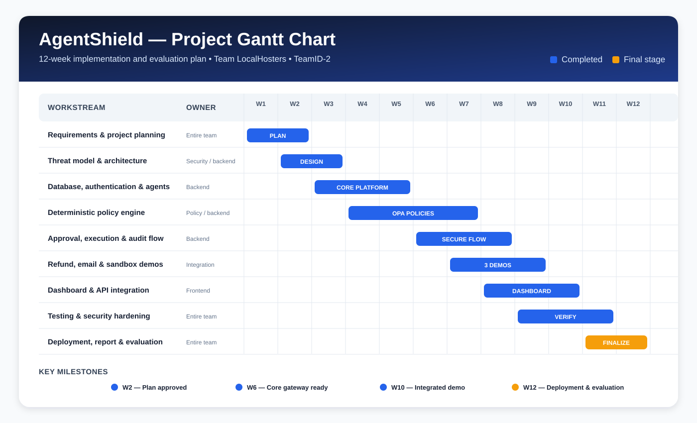

# AgentShield project milestone plan

**Team:** LocalHosters  
**Assigned team ID:** TeamID-2  
**Project:** AgentShield

## Milestones

| Week | Milestone | Evidence / deliverable |
|---|---|---|
| 2 | Planning approved | Requirements, project scope and architecture direction |
| 6 | Core security gateway ready | Database, authentication, agent registry and deterministic policies |
| 10 | Integrated demonstration ready | Refund, email and sandbox tools connected to the dashboard |
| 12 | Deployment and evaluation | Public Vercel application, Neon database, GitHub repository and verification |

## Current status

The working application is deployed for evaluation. Core development, policy
integration, the three demonstration domains, testing and deployment are complete.
Final report preparation remains the last documentation activity.

**Working application:** https://agentshield-demo.vercel.app  
**Repository:** https://github.com/amarjit81/AgentShield
