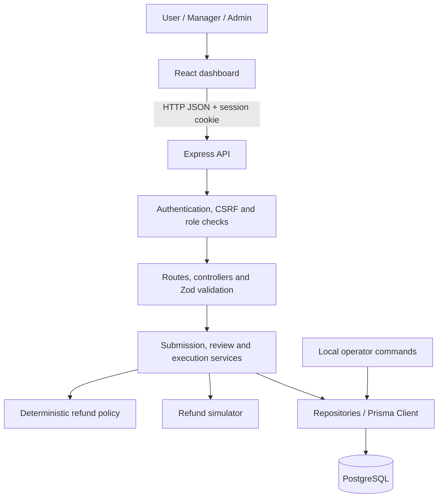

# AgentShield — Project and Architecture Overview

**Status:** Working local refund gateway, as of 10 October 2026.

## 1. What we are building

AgentShield controls whether an agent-requested action may execute. It checks
identity, ownership, tool permission, policy, and approved action details, then
records the outcome for review.

The implemented use case is **simulated refunds in INR**. Users submit requests
through registered agents; larger refunds require a Manager or Admin's approval.
The backend owns the decisions and execution checks. No payment provider is
connected and no real money moves.

## 2. Architecture

The application is a **React frontend with a modular Express backend and a
PostgreSQL database**. One backend process handles authentication, policy,
reviews, execution, and audit persistence.

| Layer | Responsibility | Main location |
|---|---|---|
| Dashboard | Login, agent selection, refund submission, review, status, receipt and audit display | `src/App.jsx`, `src/components/` |
| Browser API helpers | JSON requests, CSRF headers, response/error handling | `src/services/` |
| API boundary | Route protection, input validation and HTTP responses | `backend/src/routes/`, `controllers/`, `schemas/` |
| Business logic | Agent access, policy decisions, approval snapshots and verified execution | `backend/src/services/` |
| Persistence | Transactional writes and database queries | `backend/src/repositories/`, `lib/prisma.js` |
| Database definition | Models, relations, constraints and additive migrations | `backend/prisma/` |
| Local administration | Account creation, agent registration/configuration and demo setup | `backend/scripts/` |

The stack uses React 19, Vite, Material UI, JavaScript, Node.js, Express 5,
Zod 4, Prisma 6.12, and PostgreSQL. Vitest and Supertest verify the backend.
During development, Vite forwards `/api` requests to Express, keeping browser
requests on the same origin. The dashboard polls a selected request every four
seconds; agent settings refresh manually.

## 3. Authentication, roles and agents

Passwords are hashed with bcrypt. Login creates a **30-minute database session
and a signed JWT in an HttpOnly, SameSite=Strict cookie**. Production mode enables
Secure cookies. Each authenticated request checks both the JWT and the current
database session/user, so logout revokes access and role changes take effect
without waiting for token expiry. Mutation requests require a session-bound CSRF
token. Login also has origin checks and a per-process rate limit.

| Role | Implemented access |
|---|---|
| USER | Submit through own agents; read and execute own requests |
| MANAGER / ADMIN | Read and execute accessible requests across users; approve or reject pending requests |
| Every role | Must own the selected agent to submit a new request; agent listing returns only own agents |

An agent has an ID, name, owner, active status, and explicit allowed tools.
Only `REFUND` is supported, and permissions default to empty. Agent IDs identify
registered records; they do not authenticate an independent agent process.
Accounts and agent settings are provisioned through trusted local commands.

## 4. Complete refund flow

1. **Submit:** The user chooses an agent and enters an amount. Zod validates the
   request. The backend locks the agent row and requires an active, owned agent
   with REFUND permission. Denial happens before policy evaluation or request saving.
2. **Evaluate and save:** Deterministic JavaScript rules produce a decision.
   The request, policy snapshot, and initial audit events are saved atomically.
3. **Review when required:** A Manager/Admin approves or rejects a pending
   request. Approval stores the reviewer and the exact agent, action, target,
   amount, and currency being authorized.
4. **Verify execution:** The backend locks the request, checks authorization and
   replay, compares attempted details with the saved snapshot, then locks and
   rechecks the agent's current status, permission, and original request owner.
5. **Execute and record:** The simulator generates a receipt. Execution record,
   EXECUTED status, and audit event commit together. The dashboard retrieves them
   from the backend and recovers the saved selection after reload.

| Refund amount | Policy decision | Initial request status |
|---|---|---|
| Positive, up to INR 5,000 | ALLOW | AUTHORIZED |
| Above INR 5,000 through INR 20,000 | REQUIRE_APPROVAL | PENDING_APPROVAL |
| Above INR 20,000 | BLOCK | BLOCKED |

The dashboard automatically requests execution for ALLOW. A pending request
becomes APPROVED or REJECTED after review; an authorized/approved request can
become EXECUTED. Blocked, pending, or rejected requests cannot execute.

Tampered details and replay attempts are denied and audited. Disabling an agent
or removing permission after approval also prevents execution. Such a denial
preserves the authorization without creating a receipt; restoring access permits
a matching retry. Simulator failure rolls back execution writes. A separate
failure audit is attempted if the database remains available.

## 5. Database and API

| Model | Stores |
|---|---|
| User | Email, password hash, role and active status |
| AuthSession | User, CSRF token and expiry |
| Agent | Owner, identifier, status and tool grants |
| ActionRequest | Owner, agent ID, action, target, arguments and current status |
| PolicyDecision | Original decision, reason, limits and policy version |
| ApprovalRecord | Review decision, reviewer and exact action snapshot |
| ExecutionRecord | Simulated receipt; at most one per request |
| AuditEvent | Ordered request events, reasons, attempted details and actor information |

Users own agents and requests. Each request has one policy decision, at most one
review and execution, and many audit events. The request retains its agent ID as
a string; current registration is checked by the services. Transactions, row locks,
and the unique execution constraint protect consistent state and duplicate refusal.
Five additive migrations define the current schema without resetting existing data.

The API provides login/session/logout under `/api/auth`, owned-agent listing at
`GET /api/agents`, and create/read/review/execute/paginated-audit operations under
`/api/actions`. Validation, authentication, permission and state failures return
structured errors rather than being displayed as successful actions.

## 6. What is complete and what remains

The working slice includes authenticated role journeys, agent permissions,
deterministic policy, persisted approval snapshots, execution-time checks,
tampering/replay refusal, simulated receipts, audit display, polling, recovery,
and repeatable demo fixtures with User/Manager accounts and four agent scenarios.

**Verification:** 97 backend tests passed; frontend production build passed;
Chrome verified the two-account approval journey, denial cases, post-approval
permission withdrawal/restoration, execution, reload and replay. Database checks
confirmed saved status and receipt counts. Verification used disposable PGlite;
ordinary PostgreSQL multi-connection lock competition remains untested.

This is a local simulator slice, not the full planned MVP. Independent agent
credentials, email/file tools, approval expiry/revocation, audit search, optional
AI classification, OPA/Cedar, and production deployment remain future work.
It does not intercept other AI apps or operating-system calls. Audit is append-only
through the API, not tamper-proof against database administrators. External payments
would require their own idempotency and recovery design.

For setup and rehearsal, see [the presentation walkthrough](PRESENTATION_WALKTHROUGH.md).
For exact functions, contracts, commands, history and verification details, see
[the living implementation guide](IMPLEMENTATION_GUIDE.md).
